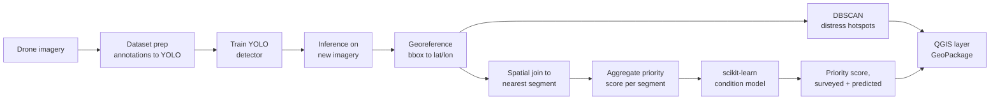

# Drone-Based Pavement Distress Detection & Maintenance Prioritization

Detect and classify road-surface distress (cracks, potholes) from **UAV / drone imagery**
using a deep-learning object detector, then **geolocate** each detection, **cluster** it into
spatial hotspots, **aggregate** it onto road segments, predict condition where no imagery
exists, and export a **QGIS-ready prioritization layer** that ranks which segments need
maintenance first.

> The goal is not only to detect damage on an image, but to turn raw drone footage into a
> decision-support product for **infrastructure asset management** — collect condition data,
> centralize it, analyze it, and recommend where to intervene first.

---

## In plain terms

> Roads wear down over time — cracks, potholes. Today, inspecting them is often done on foot or
> by truck: slow and expensive. This project shows how a **drone flying over the road** can do
> that job faster: an AI trained to recognize cracks and potholes automatically spots the damage
> in the photos, places it on a real map, groups nearby damage into "problem zones," then
> calculates a **priority score** to know which stretch of road to fix first. For sections the
> drone hasn't surveyed yet, a second model uses simple information (road type, traffic, age) to
> still estimate their likely condition. The result is a map that shows, street by street, where
> to step in first — exactly the kind of tool a city would use to plan road maintenance on a
> limited budget.

---

## Main idea behind this project

Infrastructure asset management runs on condition data, and condition data is expensive to
collect at scale — someone has to physically inspect every stretch of road. This project's
central idea is that a drone survey plus machine learning can shorten that loop: instead of a
person rating pavement condition by eye, a trained model does the visual inspection, a
geospatial layer turns scattered detections into a per-road-segment picture, and a second model
extends that picture to segments not yet surveyed. The deliverable is not a detection model in
isolation — it's the full chain from **raw imagery to a ranked list of where to intervene
first**, which is the actual decision an asset-management team needs to make.

---

## Executive summary

Given ~2,440 UAV images of pavement, a YOLO detector finds and classifies six distress types
(cracks, potholes, repairs). Detections are geolocated, clustered into damage hotspots with
DBSCAN, and aggregated into a per-segment maintenance-priority score. A separate scikit-learn
model, trained on ~16,000 real segments from the City of Montréal's own pavement condition
survey, then estimates a segment's real PCI from attributes available city-wide (length,
borough, roughness) alone — useful for segments a drone hasn't surveyed yet. Everything ends up
in a GeoPackage that opens directly in QGIS with graduated priority symbology.

No real GPS-tagged flight was available for this project, so the **survey GPS coordinates and
the 8 segment boundaries are an honestly-labeled synthetic demo** built on a real Montréal
street. Everything downstream of that — the detector, the condition model, and its training and
ground-truth data — is real. See [Limitations](#limitations--honest-caveats) for exactly where
the line is drawn.

---

## Problem statement

Manual road inspection is slow, subjective, and expensive — an inspector walks or drives the
network and rates condition by eye, which doesn't scale to an entire municipal or provincial
road network on a useful cadence. Drones can survey pavement quickly and cheaply, but raw
imagery is only useful once it becomes **structured, geolocated, prioritized information** that
an asset-management team can act on. This project builds that bridge end to end:

`drone image → detected distress → geographic location → hotspots & segment scores → predicted condition → prioritized map`

---

## Pipeline overview



---

## Two complementary ML engines

This project deliberately uses the **right tool for the right job** — a distinction that
matters in practice:

| Engine | Library | Job | Data type |
|---|---|---|---|
| **YOLO detector** | PyTorch / ultralytics | Find & classify distress on imagery | Images (deep learning) |
| **Segment condition model** | scikit-learn | Predict condition from segment attributes | Tabular (classic ML) |

The deep-learning model sees the pixels; the classic model reasons over city-wide attributes
(segment length, borough, ride roughness) to **estimate condition on segments the drone never
flew over** — the same imputation logic used in real asset-management workflows.

---

## Methodology

**1–2. Dataset prep & training.** Pascal VOC annotations from UAV-PDD2023 are converted to YOLO
format (normalized bbox + class id per image) with an 80/10/10 train/val/test split
([`prepare_dataset.py`](src/data/prepare_dataset.py)). A `yolo11n` detector is fine-tuned for 50
epochs — nano-sized because training runs on a free Colab GPU, not local hardware.

**3. Inference.** The trained weights run on the held-out test images
([`detect.py`](src/inference/detect.py)), producing a bounding box, class, and confidence per
detection.

**4. Georeferencing.** Each detection's pixel bounding box is converted to a real-world
coordinate. Two strategies are supported: image EXIF GPS tags, or an orthomosaic's affine
transform ([`georeference.py`](src/geo/georeference.py)); this project uses the EXIF path with
simulated tags (see [Data](#data)).

**5. Hotspot detection (DBSCAN).** All georeferenced points are projected into a metric CRS and
clustered with **DBSCAN** — density-based, unsupervised, no need to pre-specify a number of
clusters. A cluster ("hotspot") is a neighborhood of at least `hotspot_min_samples` detections
within `hotspot_eps_m` metres of each other; isolated detections are labeled noise (`-1`) and
excluded. This runs independently of segment boundaries, because a real concentration of damage
can straddle two segments ([`aggregate_to_segments.py`](src/geo/aggregate_to_segments.py)).

**6. Spatial join & segment scoring.** Separately, each detection is snapped to its nearest road
segment (`geopandas.sjoin_nearest`, capped at `snap_distance_m`). Per segment, a priority score
is the confidence-weighted sum of severity weights across its detections — simple and
explainable by design, easy to defend to a non-technical stakeholder.

**7. Segment condition model (scikit-learn).** Trained on the City of Montréal's real, measured
pavement condition survey — ~16,000 segments city-wide, with a real Pavement Condition Index
(PCI) per segment ([`fetch_montreal_pci_data.py`](src/model/fetch_montreal_pci_data.py)). A
`ColumnTransformer` (one-hot borough, scaled numeric features) feeds a regressor inside a
`Pipeline`. Random Forest and Gradient Boosting are compared with 5-fold cross-validation, the
winner is tuned with `GridSearchCV`, and feature importances are extracted — the standard
"compare → tune → explain" workflow for tabular ML
([`segment_model.py`](src/model/segment_model.py)). The 8 drone-surveyed demo segments are then
spatially matched to the real Montréal segments that overlap them, so they inherit real
attributes *and* a real ground-truth PCI to compare against — see [Results](#results).

**8. QGIS export.** Scored segments and hotspots are written as two layers of one GeoPackage
([`export_qgis.py`](src/geo/export_qgis.py)), ready for graduated symbology in QGIS.

---

## Data


Built around an open UAV pavement-distress dataset:

| Dataset | Content | Notes |
|---|---|---|
| **UAV-PDD2023** | ~2,440 drone images, ~11k instances (6 classes) | Used for detector training/eval |

Distress classes: longitudinal crack, transverse crack, oblique crack, alligator crack,
pothole, repair. Datasets are **not** committed — see [`data/README.md`](data/README.md).

**What's real vs. synthetic, explicitly:**

| Component | Status |
|---|---|
| Detector training images & labels | Real (UAV-PDD2023) |
| Detector inference on held-out test images | Real model output |
| Street geometry | **Real** — [`fetch_osm_route.py`](src/geo/fetch_osm_route.py) pulls the actual shape of Chemin de la Côte-Sainte-Catherine, Montréal (~1.9 km, 28 OpenStreetMap way segments stitched into one line) via the Overpass API. |
| GPS coordinates on the "survey" images | **Synthetic** — UAV-PDD2023 images carry no GPS EXIF (they're research crops, not flight photos). [`generate_synthetic_survey.py`](src/data/generate_synthetic_survey.py) simulates a drone flying along that real street's curve and stamps each test image with a point spaced by real distance along it — a fake flight, over a real road shape. |
| Road segment *boundaries* | **Synthetic, real shape** — no municipal road-segment layer was used for the drone demo itself, so [`generate_synthetic_segments.py`](src/geo/generate_synthetic_segments.py) splits that same real street into 8 equal-length segments. |
| Road segment *attributes* (length, borough, roughness) | **Real** — [`segment_model.py`](src/model/segment_model.py) spatially matches each of the 8 demo segments to the real City of Montréal segments that overlap it and inherits their measured values. |
| Segment condition model's training data | **Real** — [`fetch_montreal_pci_data.py`](src/model/fetch_montreal_pci_data.py) downloads ~16,000 real, measured segments (Pavement Condition Index) from the City of Montréal's open data portal. No synthetic/formula-based data remains in this project. |
| Ground truth for the 8 demo segments | **Real** — the City of Montréal's own PCI rating for that exact stretch of Chemin de la Côte-Sainte-Catherine, used as an independent check on both the drone-based score and the model's prediction. |

This is disclosed here instead of hidden because the whole point of the project is the
**pipeline architecture**, not a claim of field-validated results — see
[Limitations](#limitations--honest-caveats).

---

## Results

*(Reproduce all of this with `python -m src.reporting.make_figures` after running the pipeline
— see [Usage](#usage). The two YOLO figures additionally need `models/baseline/results.csv`,
downloaded once from the Colab training run since training happens off-machine. The three map
figures need internet access, to fetch basemap tiles.)*

### Detector

Baseline `yolo11n`, imgsz 640, 50 epochs, batch 16, trained on a free Colab T4. Final-epoch
validation metrics (from the Colab run's `results.csv`):

| Metric | Value |
|---|---|
| Precision | 0.563 |
| Recall | 0.505 |
| mAP@50 | 0.472 |
| mAP@50-95 | 0.222 |


Both losses drop smoothly with no sign of overfitting by epoch 50 (val loss tracks train loss
closely) — the detector was likely still improving and would benefit from more epochs or a
larger backbone (`yolo11s`/`yolo11m`) rather than being at a plateau.


Most confusion happens between visually similar crack types — e.g. 72 `oblique_crack`
instances predicted as `transverse_crack` — which makes sense since the distinction is
genuinely subtle (a crack's angle relative to the pavement edge) even for a human labeler. The
large `background` column shouldn't be read as a literal false-positive rate: ultralytics
computes this matrix across many low-confidence candidate boxes to trace the full precision-recall
curve, not just the boxes kept at the operational `conf=0.25` threshold — the precision/recall
in the table above are the numbers that reflect real operating behavior.


The test set is heavily imbalanced — 425 transverse-crack detections vs. 4 pothole detections —
so the aggregate numbers above are mostly driven by the crack classes; pothole precision/recall
individually are not statistically meaningful yet at this sample size.

### Detections in space


Before aggregation, this is what the detector actually produced geographically: every detection
from the class-distribution chart above, placed at its (simulated) survey position and colored by
class. Cracks (orange/green/brown) dominate visually simply because they dominate the counts —
this map is the geospatial complement to that bar chart, not new information, but seeing *where*
detections concentrate is exactly what a maintenance planner needs before hotspot/segment logic
ever runs.

### Hotspot detection

DBSCAN (`eps=20m`, `min_samples=3`) found **1 hotspot** covering nearly the entire synthetic
route. That's expected, not a bug: the simulated drone images are spaced a few metres apart
along one continuous line, so almost every point has ≥3 neighbours within 20 m, and DBSCAN
correctly merges them into a single connected region (a known "chaining" behavior of
density-based clustering on near-uniform linear data). A real, non-uniform survey — several
distinct streets, gaps between flights — would produce several separate hotspots instead of one.

### Segment condition model

5-fold cross-validated R² on ~13,000 real Montréal segments (Longueur, Arrondissement, Indice
IRI → Indice PCI), before and after tuning:

| Model | CV R² |
|---|---|
| Random Forest | 0.192 |
| Gradient Boosting (selected) | 0.291 |

Tuned Gradient Boosting (`learning_rate=0.05`, `n_estimators=300`) on the held-out test split
(~3,300 real segments): **MAE 15.4, RMSE 18.8, R² 0.273**.

These numbers are far lower than a model would get on a formula-generated target, and that's the
point: predicting a city's real, measured pavement condition from just length/borough/roughness
is a genuinely hard problem — real PCI also depends on material, maintenance history, and traffic
loading, none of which are in this feature set. An R² of 0.27 on a held-out real test set is a
credible result for this feature set, not a broken model.


`indice_iri` (roughness) dominates, which makes physical sense — it's the closest available
proxy for surface condition; individual boroughs barely move the prediction on their own.

### Three ways to score the same 8 segments


Each of the 8 drone-surveyed segments now has three independent numbers: our drone-based
`priority_score` (sum of weighted detections — higher is worse), the tabular model's
`predicted_score` (same scale), and the City of Montréal's real, measured PCI for that exact
stretch (0–100, higher is *better* — a different, bounded scale, so it gets its own panel above
rather than being forced onto the same axis).

They don't fully agree, and the most interesting case is **segment 6**: it has the *worst* real
PCI of all 8 (31, "très mauvais") but only a middling drone-based priority score. Our proxy
metric — counting and weighting visible cracks/potholes from images — and the city's official
PCI — which also factors in rutting and ride roughness — are measuring related but different
things. That's a legitimate, reportable finding, not noise: it shows exactly where a
vision-based proxy and an official condition index can diverge, which is useful information for
anyone deciding how much to trust drone-based scoring on its own.

### Top segments by priority

| Segment | Priority score | Detections | Dominant issue |
|---|---|---|---|
| 3 | 206.9 | 198 | alligator_crack |
| 0 | 205.6 | 211 | alligator_crack |
| 5 | 176.5 | 155 | alligator_crack |
| 6 | 138.0 | 116 | alligator_crack |
| 2 | 129.1 | 116 | pothole |
| 1 | 115.7 | 88 | pothole |
| 7 | 101.5 | 98 | pothole |
| 4 | 84.6 | 65 | transverse_crack |

### Priority map


Generated by `make_figures.py` from the exact same GeoPackage QGIS would open
(`outputs/segment_priority.gpkg`, layers `segment_priority` + `distress_hotspots`), styled with
a graduated color scale, a real basemap, scale bar, and north arrow — a rendered PNG instead of a
raw QGIS screenshot, so it's both reproducible and presentable in a README. Open the same file in
QGIS to explore it interactively (pan, zoom, inspect attributes per segment).

---

## Limitations & honest caveats

- **Simulated GPS and synthetic segment boundaries.** GPS coordinates on the survey images and
  the 8 equal-length segment boundaries are simulated, not field-collected — see [Data](#data).
  The detector is trained on real imagery/labels, and the condition model on real, measured PCI
  data (see below).
- **Two different scoring systems, not directly comparable on one axis.** The drone-based
  `priority_score` and the model's `predicted_score` share a scale; the city's real PCI is a
  different, bounded 0–100 condition index. As shown above, they don't fully agree (segment 6 is
  the clearest case) — that's a real, reportable finding about where a vision-based proxy and an
  official index diverge, not a bug to hide.
- **Modest R² (0.27) on the condition model.** Honest for the feature set used (segment length,
  borough, roughness) — real PCI also depends on material and maintenance history, which aren't
  in this data. A higher R² would need richer real features, not a different algorithm.
- **Small, imbalanced test set** for the detector (e.g. only 4 pothole detections) — per-class
  metrics for rare classes are not statistically reliable yet.
- **DBSCAN chaining on near-uniform spacing.** With detections spaced evenly along a single
  line, the algorithm tends to merge everything into one hotspot rather than several. Realistic,
  irregular flight coverage would better showcase this step.
- **Tiny synthetic road network** (8 segments, one street) — enough to demonstrate the spatial
  join and aggregation logic, not representative of a real municipal network's scale.

---

## Key concepts practiced

**Computer vision / deep learning:** object detection, transfer learning, train/val/test
split, mAP / precision / recall evaluation.

**scikit-learn (classic ML):** `Pipeline` + `ColumnTransformer` (categorical encoding,
scaling), **Random Forest** & **Gradient Boosting**, **cross-validation**, **GridSearchCV**
hyperparameter tuning, **feature importance**, regression metrics (MAE / RMSE / R²), and
**DBSCAN** density-based clustering for geographic distress hotspots (unsupervised).

**GIS / geospatial:** coordinate reference systems (geographic vs projected, EPSG codes),
vector data & GeoDataFrames, **spatial joins** (`sjoin_nearest`, `sjoin`), reprojection,
multi-layer GeoPackages, and **graduated (choropleth) symbology** in QGIS.

**SQL / data engineering:** relational schema design (reference / fact / result tables), foreign
keys, loading pipeline outputs into SQLite, and pulling real data from a public open-data API
(City of Montréal's CKAN portal) instead of a hand-made dataset.

> Every concept above earns its place in the pipeline. Nothing is added just to appear on a
> checklist — if a technique had no logical use here, it was intentionally left out.

---

## Installation

```bash
git clone https://github.com/<your-username>/pavement-distress-drone.git
cd pavement-distress-drone
python -m venv .venv && source .venv/bin/activate   # Windows: .venv\Scripts\activate
pip install -r requirements.txt
```

A GPU helps for training YOLO. If you don't have one, the training step runs well on a free
**Google Colab** or **Kaggle** GPU notebook. The scikit-learn and geospatial steps run fine on
any CPU.

---

## Usage

```bash
# 0. Demo data setup -- only needed to reproduce the synthetic demo; skip
#    these three if you have real GPS-tagged imagery and a real segments layer.
python -m src.geo.fetch_osm_route                                  # -> data/road_route.geojson
python -m src.data.generate_synthetic_survey --config configs/config.yaml
python -m src.geo.generate_synthetic_segments --config configs/config.yaml

# 1. Convert dataset annotations to YOLO format
python -m src.data.prepare_dataset --config configs/config.yaml

# 2. Train the YOLO detector
python -m src.train.train --config configs/config.yaml

# 3. Run inference on new drone imagery
python -m src.inference.detect --config configs/config.yaml --images data/new_survey/

# 4. Georeference detections (image geotags or orthomosaic transform)
python -m src.geo.georeference --config configs/config.yaml

# 5. DBSCAN hotspots + spatial join + aggregate to road segments
python -m src.geo.aggregate_to_segments --config configs/config.yaml

# 6a. Download the real Montréal pavement condition survey (~16,000 segments)
python -m src.model.fetch_montreal_pci_data --config configs/config.yaml

# 6b. Train the scikit-learn condition model & predict per-segment condition
python -m src.model.segment_model --config configs/config.yaml

# 7. Export a QGIS-ready GeoPackage (segment_priority + distress_hotspots layers)
python -m src.geo.export_qgis --config configs/config.yaml

# 8. Regenerate the README figures from the outputs above
python -m src.reporting.make_figures

# 9. Load segments, detections, and scores into a queryable SQLite database
python -m src.db.load_to_sqlite --config configs/config.yaml
```

---

## Project structure

```
pavement-distress-drone/
├── configs/config.yaml               # single source of truth for paths & params
├── src/
│   ├── data/prepare_dataset.py       # annotations -> YOLO format
│   ├── data/generate_synthetic_survey.py   # simulated GPS-tagged survey (demo)
│   ├── train/train.py                # train the YOLO detector
│   ├── inference/detect.py           # run detection on new imagery
│   ├── model/fetch_montreal_pci_data.py  # download real City of Montréal PCI segments
│   ├── model/segment_model.py        # scikit-learn tabular condition model
│   ├── reporting/make_figures.py     # regenerate README figures from outputs/
│   └── geo/
│       ├── fetch_osm_route.py            # pull a real street's shape from OpenStreetMap
│       ├── georeference.py               # pixel bbox -> geographic coordinates
│       ├── generate_synthetic_segments.py# real street split into synthetic segments (demo)
│       ├── aggregate_to_segments.py      # DBSCAN hotspots + spatial join + priority score
│       └── export_qgis.py                # write GeoPackage for QGIS
│   └── db/load_to_sqlite.py          # load outputs/ into a queryable SQLite database
├── sql/schema.sql                    # the 3-table schema (segments, detections, segment_scores)
├── notebooks/                        # exploration & demo
├── figures/                          # committed, reproducible README figures
├── data/                             # datasets (git-ignored)
├── models/                           # trained weights (git-ignored)
└── outputs/                          # detections, hotspots, scored segments, pavement.db (git-ignored)
```

---

## Roadmap

- [x] Baseline YOLO detector trained on UAV-PDD2023
- [x] Georeferencing from simulated EXIF geotags
- [x] DBSCAN distress hotspots
- [x] Spatial join + segment priority scoring
- [x] scikit-learn condition model (Pipeline, CV, GridSearchCV, feature importance)
- [x] Segment condition model trained on real data (City of Montréal PCI, ~16,000 segments)
- [x] QGIS layer export (segments + hotspots)
- [ ] Per-class detector evaluation on a held-out split, with a larger/rebalanced dataset
- [ ] Orthomosaic support (GeoTIFF affine transform)
- [ ] Real road-network segments (OSM extract) instead of the synthetic 8-segment demo boundaries
- [ ] Airflow DAG orchestrating the 7 pipeline steps
- [x] Detections & segment scores persisted to SQLite (`sql/schema.sql`, `src/db/load_to_sqlite.py`)
- [ ] Short demo notebook
- [ ] (Stretch) Streamlit demo for drag-and-drop inference

---

## License

MIT — see [LICENSE](LICENSE).

## Author

**Akram Bouznad** — Research Master's (M.A.Sc.), Industrial Engineering (Data Science),
Polytechnique Montréal / CIRANO.
