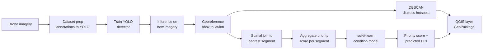
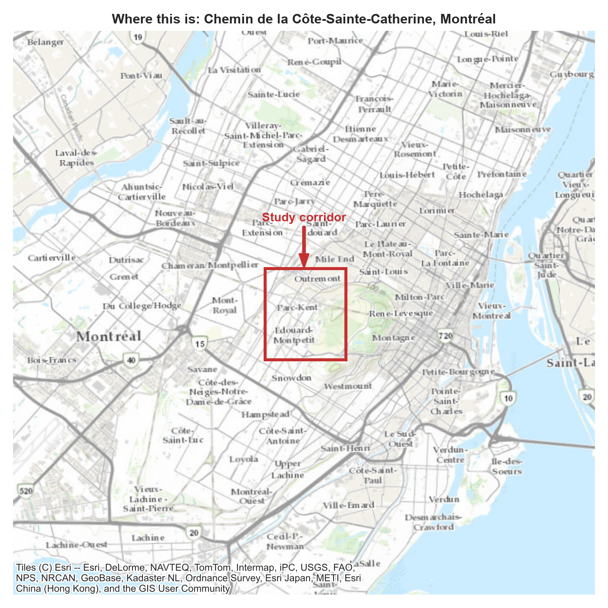
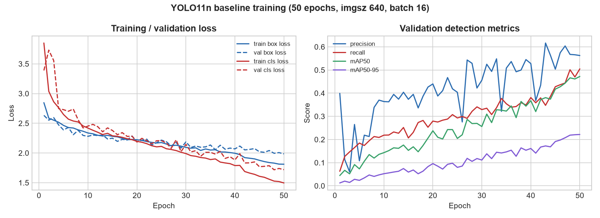
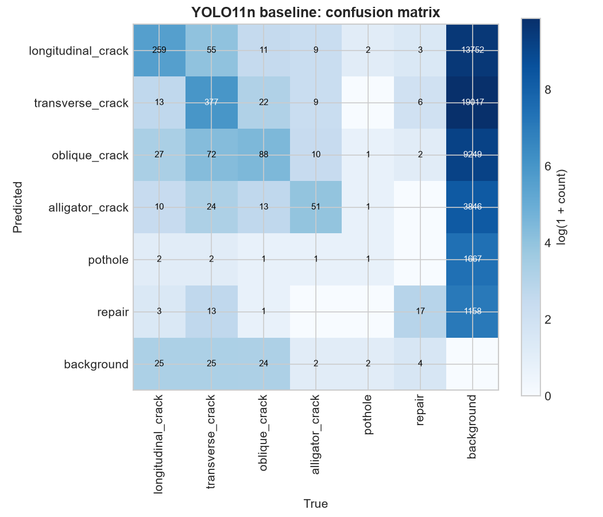
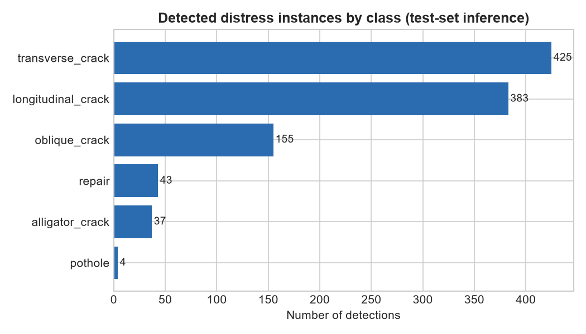
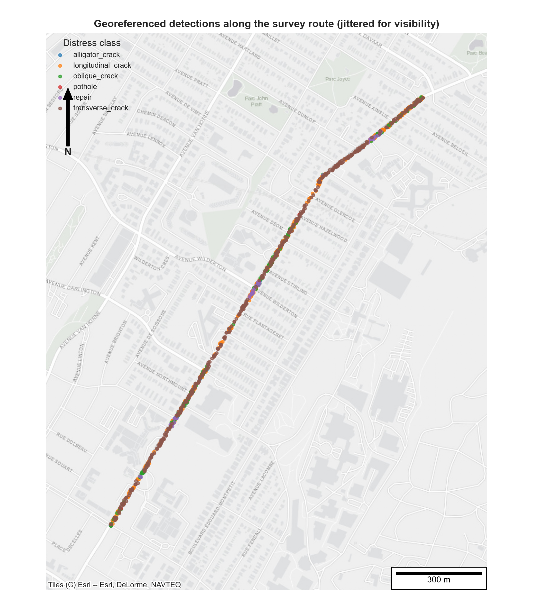
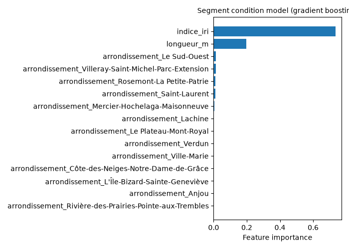
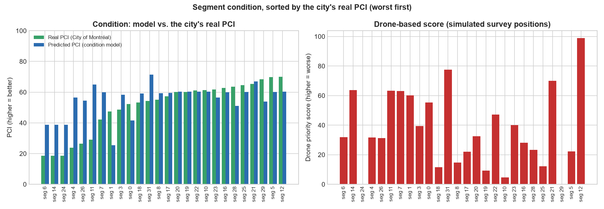
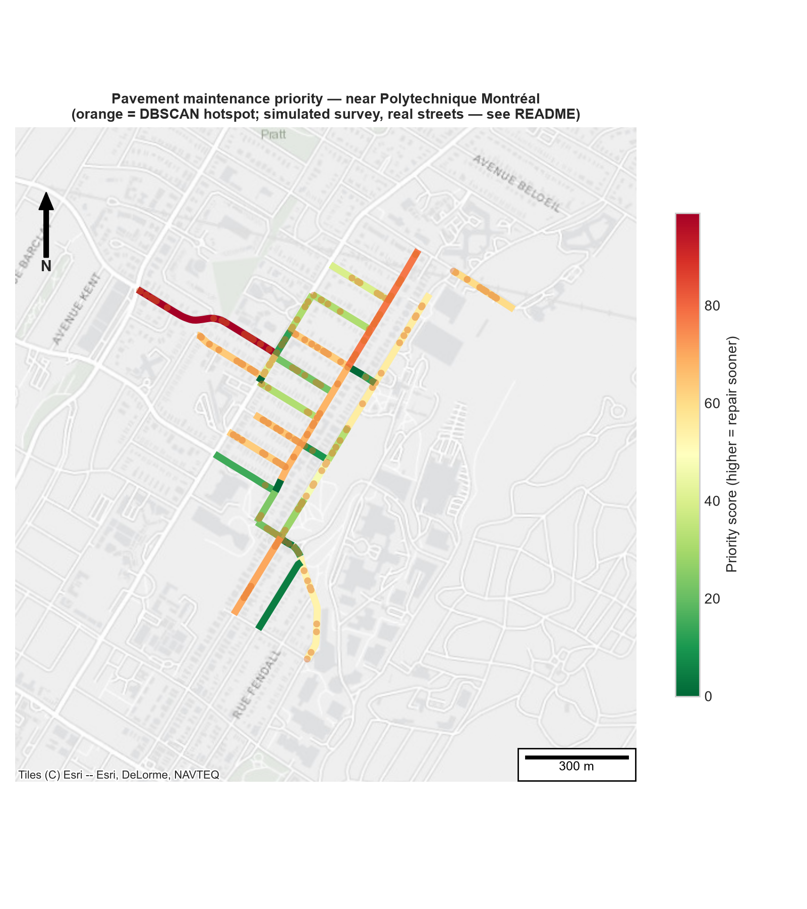

# Drone-Based Pavement Distress Detection & Maintenance Prioritization

Detect and classify road-surface distress (cracks, potholes) from **UAV / drone imagery**
using a deep-learning object detector, then **geolocate** each detection, **cluster** it into
spatial hotspots, **aggregate** it onto road segments, predict condition where no imagery
exists, and export a **QGIS-ready prioritization layer** that ranks which segments need
maintenance first.

> The goal is not only to detect damage on an image, but to turn raw drone footage into a
> decision-support product for **infrastructure asset management** — collect condition data,
> centralize it, analyze it, and recommend where to intervene first.

---

## In plain terms

> Roads wear down over time — cracks, potholes. Today, inspecting them is often done on foot or
> by truck: slow and expensive. This project shows how a **drone flying over the road** can do
> that job faster: an AI trained to recognize cracks and potholes automatically spots the damage
> in the photos, places it on a real map, groups nearby damage into "problem zones," then
> calculates a **priority score** to know which stretch of road to fix first. For sections the
> drone hasn't surveyed yet, a second model uses simple information the city already has (street
> length, borough, road roughness, pavement age) to still estimate their likely condition. The
> result is a map that shows, street by street, where to step in first — exactly the kind of tool a city would use to plan road maintenance on a
> limited budget.

---

## Main idea behind this project

Infrastructure asset management runs on condition data, and condition data is expensive to
collect at scale — someone has to physically inspect every stretch of road. This project's
central idea is that a drone survey plus machine learning can shorten that loop: instead of a
person rating pavement condition by eye, a trained model does the visual inspection, a
geospatial layer turns scattered detections into a per-road-segment picture, and a second model
extends that picture to segments not yet surveyed. The deliverable is not a detection model in
isolation — it's the full chain from **raw imagery to a ranked list of where to intervene
first**, which is the actual decision an asset-management team needs to make.

---

## Executive summary

Given ~2,440 UAV images of pavement, a YOLO detector finds and classifies six distress types
(cracks, potholes, repairs). Detections are geolocated, clustered into damage hotspots with
DBSCAN, and aggregated into a per-segment maintenance-priority score. A separate scikit-learn
model, trained on ~16,000 real segments from the City of Montréal's own pavement condition
survey, then estimates a segment's real PCI from attributes available city-wide (length,
borough, roughness, pavement age and material) alone — useful for segments a drone hasn't surveyed yet. Everything ends up
in a GeoPackage that opens directly in QGIS with graduated priority symbology.

No real GPS-tagged flight was available for this project, so the **survey GPS coordinates are an
honestly-labeled synthetic demo** — simulated across a real street network (32 segments, 15
real streets in a Montréal neighbourhood near Polytechnique, fetched from OpenStreetMap).
Everything downstream of that — the segment boundaries themselves, the detector, the condition
model, and its training and ground-truth data — is real. See
[Limitations](#limitations--honest-caveats) for exactly where
the line is drawn.

> **Quickest way in:** the [walkthrough notebook](notebooks/demo_pipeline.ipynb) runs through
> every step (detection, map, hotspots, priority, condition model, SQL) with its outputs saved,
> so it reads directly on GitHub. The trained weights and pipeline outputs are committed, so it
> also re-runs locally in under a minute on a CPU, with no dataset download.

---

## Problem statement

Manual road inspection is slow, subjective, and expensive — an inspector walks or drives the
network and rates condition by eye, which doesn't scale to an entire municipal or provincial
road network on a useful cadence. Drones can survey pavement quickly and cheaply, but raw
imagery is only useful once it becomes **structured, geolocated, prioritized information** that
an asset-management team can act on. This project builds that bridge end to end:

`drone image → detected distress → geographic location → hotspots & segment scores → predicted condition → prioritized map`

---

## Pipeline overview



---

## Two complementary ML engines

This project deliberately uses the **right tool for the right job** — a distinction that
matters in practice:

| Engine | Library | Job | Data type |
|---|---|---|---|
| **YOLO detector** | PyTorch / ultralytics | Find & classify distress on imagery | Images (deep learning) |
| **Segment condition model** | scikit-learn | Predict condition from segment attributes | Tabular (classic ML) |

The deep-learning model sees the pixels; the classic model reasons over city-wide attributes
(segment length, borough, ride roughness, pavement age) to **estimate condition on segments the drone never
flew over** — the same imputation logic used in real asset-management workflows.

---

## Methodology

**1–2. Dataset prep & training.** Pascal VOC annotations from UAV-PDD2023 are converted to YOLO
format (normalized bbox + class id per image) with an 80/10/10 train/val/test split
([`prepare_dataset.py`](src/data/prepare_dataset.py)). A `yolo11n` detector is fine-tuned for 50
epochs — nano-sized because training runs on a free Colab GPU, not local hardware.

**3. Inference.** The trained weights run on the held-out test images
([`detect.py`](src/inference/detect.py)), producing a bounding box, class, and confidence per
detection.

**4. Georeferencing.** Each detection's pixel bounding box is converted to a real-world
coordinate. Two strategies are supported: image EXIF GPS tags, or an orthomosaic's affine
transform ([`georeference.py`](src/geo/georeference.py)); this project uses the EXIF path with
simulated tags (see [Data](#data)).

**5. Hotspot detection (DBSCAN).** All georeferenced points are projected into a metric CRS and
clustered with **DBSCAN** — density-based, unsupervised, no need to pre-specify a number of
clusters. A cluster ("hotspot") is a neighborhood of at least `hotspot_min_samples` detections
within `hotspot_eps_m` metres of each other; isolated detections are labeled noise (`-1`) and
excluded. This runs independently of segment boundaries, because a real concentration of damage
can straddle two segments ([`aggregate_to_segments.py`](src/geo/aggregate_to_segments.py)).

**6. Spatial join & segment scoring.** Separately, each detection is snapped to its nearest road
segment (`geopandas.sjoin_nearest`, capped at `snap_distance_m`). Per segment, a priority score
is the confidence-weighted sum of severity weights across its detections — simple and
explainable by design, easy to defend to a non-technical stakeholder.

**7. Segment condition model (scikit-learn).** Trained on the City of Montréal's real, measured
pavement condition survey — ~16,000 segments city-wide, with a real Pavement Condition Index
(PCI) per segment ([`fetch_montreal_pci_data.py`](src/model/fetch_montreal_pci_data.py)). Since
the PCI survey alone predicts poorly (length/borough/roughness aren't very descriptive of *why*
a road degrades), each segment is further enriched with its real construction/resurfacing date
and material, spatially joined from Montréal's separate "Voirie" road-asset survey — the two
datasets share no common key
([`enrich_with_voirie_age.py`](src/model/enrich_with_voirie_age.py)). A `ColumnTransformer`
(one-hot borough + material, scaled numeric features) feeds a regressor inside a `Pipeline`.
Random Forest and Gradient Boosting are compared with 5-fold cross-validation, the winner is
tuned with `GridSearchCV`, and feature importances are extracted — the standard "compare → tune
→ explain" workflow for tabular ML ([`segment_model.py`](src/model/segment_model.py)). The 32
drone-surveyed demo segments are then spatially matched to the real Montréal segments that
overlap them, so they inherit real attributes *and* a real ground-truth PCI to compare against
— see [Results](#results).

**8. QGIS export.** Scored segments and hotspots are written as two layers of one GeoPackage
([`export_qgis.py`](src/geo/export_qgis.py)), ready for graduated symbology in QGIS.

---

## Data



Built around an open UAV pavement-distress dataset:

| Dataset | Content | Notes |
|---|---|---|
| **UAV-PDD2023** | ~2,440 drone images, ~11k instances (6 classes) | Used for detector training/eval. H. Yan & J. Zhang, Hebei University of Technology, [Zenodo](https://zenodo.org/records/8429208), CC-BY 4.0 |

Distress classes: longitudinal crack, transverse crack, oblique crack, alligator crack,
pothole, repair. Datasets are **not** committed — see [`data/README.md`](data/README.md).

**What's real vs. synthetic, explicitly:**

| Component | Status |
|---|---|
| Detector training images & labels | Real (UAV-PDD2023) |
| Detector inference on held-out test images | Real model output |
| Street network & segment boundaries | **Real** — [`fetch_osm_network.py`](src/geo/fetch_osm_network.py) pulls every real drivable street (32 segments, 15 named streets) in a Montréal neighbourhood near Polytechnique from OpenStreetMap. Each segment is a real OSM way, the same block-to-block granularity the City of Montréal uses for its own PCI survey — not an arbitrary division. |
| GPS coordinates on the "survey" images | **Synthetic** — UAV-PDD2023 images carry no GPS EXIF (they're research crops, not flight photos). [`generate_synthetic_survey.py`](src/data/generate_synthetic_survey.py) assigns each test image a random point on a random real segment (weighted by segment length) — a fake flight, over real streets. |
| Road segment *attributes* (length, borough, roughness, pavement age/material) | **Real** — [`segment_model.py`](src/model/segment_model.py) spatially matches each of the 32 demo segments to the real City of Montréal segments that overlap it and inherits their measured values. |
| Segment condition model's training data | **Real** — [`fetch_montreal_pci_data.py`](src/model/fetch_montreal_pci_data.py) downloads ~16,000 real, measured segments (Pavement Condition Index) from the City of Montréal's open data portal, enriched with real pavement age/material by [`enrich_with_voirie_age.py`](src/model/enrich_with_voirie_age.py) (a second, separately sourced City of Montréal survey, spatially joined — no shared key). No synthetic/formula-based data remains in this project. |
| Ground truth for the 32 demo segments | **Real** — the City of Montréal's own PCI rating for those exact streets, used as an independent check on both the drone-based score and the model's prediction. |

This is disclosed here instead of hidden because the whole point of the project is the
**pipeline architecture**, not a claim of field-validated results — see
[Limitations](#limitations--honest-caveats).

---

## Results

*(Reproduce all of this with `python -m src.reporting.make_figures` after running the pipeline
— see [Usage](#usage). The two YOLO figures additionally need `models/baseline/results.csv`,
downloaded once from the Colab training run since training happens off-machine. The three map
figures need internet access, to fetch basemap tiles.)*

### Detector

Baseline `yolo11n`, imgsz 640, 50 epochs, batch 16, trained on a free Colab T4. Final-epoch
validation metrics (from the Colab run's `results.csv`):

| Metric | Value |
|---|---|
| Precision | 0.563 |
| Recall | 0.505 |
| mAP@50 | 0.472 |
| mAP@50-95 | 0.222 |



Both losses drop smoothly with no sign of overfitting by epoch 50 (val loss tracks train loss
closely) — the detector was likely still improving and would benefit from more epochs or a
larger backbone (`yolo11s`/`yolo11m`) rather than being at a plateau.



Most confusion happens between visually similar crack types — e.g. 72 `oblique_crack`
instances predicted as `transverse_crack` — which makes sense since the distinction is
genuinely subtle (a crack's angle relative to the pavement edge) even for a human labeler. The
large `background` column shouldn't be read as a literal false-positive rate: ultralytics
computes this matrix across many low-confidence candidate boxes to trace the full precision-recall
curve, not just the boxes kept at the operational `conf=0.25` threshold — the precision/recall
in the table above are the numbers that reflect real operating behavior.



The test set is heavily imbalanced — 425 transverse-crack detections vs. 4 pothole detections —
so the aggregate numbers above are mostly driven by the crack classes; pothole precision/recall
individually are not statistically meaningful yet at this sample size.

### Detections in space



Before aggregation, this is what the detector actually produced geographically: every detection
from the class-distribution chart above, placed at its (simulated) survey position and colored by
class. Cracks (orange/green/brown) dominate visually simply because they dominate the counts —
this map is the geospatial complement to that bar chart, not new information, but seeing *where*
detections concentrate is exactly what a maintenance planner needs before hotspot/segment logic
ever runs.

### Hotspot detection

DBSCAN (`eps=20m`, `min_samples=3`) found **84 distinct hotspots** spread across the
neighbourhood's 15 streets. This is a direct improvement from an earlier version of this demo
that surveyed a single street: with detections spread across many separate real streets instead
of one continuous line, DBSCAN's "chaining" behavior (merging everything into one blob on
near-uniform linear data) no longer dominates — the clustering now does the job it's actually
meant to do, finding real, spatially distinct concentrations of damage.

### Segment condition model

**First pass** — length, borough, and roughness only — gave a modest CV R² of 0.29 (Gradient
Boosting) and a test R² of 0.27. Predicting real pavement condition from so little was always
going to be hard: none of those three features has a strong *causal* link to why a road
degrades. So a second real dataset was added — the City of Montréal's separate "Voirie"
road-asset survey, spatially joined in (no shared key) to pull each segment's real
construction/resurfacing date (→ pavement age) and material
([`enrich_with_voirie_age.py`](src/model/enrich_with_voirie_age.py)):

| Model | CV R² — length/borough/roughness only | CV R² — + real pavement age/material |
|---|---|---|
| Random Forest | 0.192 | 0.345 |
| Gradient Boosting (selected) | 0.291 | **0.370** |

Tuned Gradient Boosting (`learning_rate=0.1`, `n_estimators=300`) on the held-out test split
(~3,300 real segments): **MAE 14.1, RMSE 17.5, R² 0.354** — up from R² 0.27. Adding one genuinely
causal real feature (pavement age) moved the needle more than switching algorithms or tuning
hyperparameters did. Still not a "field-ready" model — real PCI also depends on maintenance
history and traffic loading, which aren't in this data either — but the improvement is honest
and explainable, which matters more here than the absolute number.



`indice_iri` (roughness) still dominates, but `pavement_age_years` is now the clear second
feature — exactly the causal signal that was missing before. `materiau_chaussee` barely moves
the needle, which also makes sense: 97.5% of the surveyed streets are simply asphalt, so there's
almost no variation for the model to learn from.

### Three ways to score the same segments



26 of the 32 demo segments matched a real City of Montréal PCI segment nearby (the other 6 fall
outside the city's surveyed network — a real coverage gap, not an error). Each of those 26 now
has three independent numbers, on two different scales:

- the city's real, measured **PCI** (0–100, higher is *better*);
- the condition model's **predicted PCI** (`predicted_score`, same 0–100 scale, so it shares the
  left panel with the real PCI);
- our drone-based **`priority_score`** (confidence-weighted sum of detection severities, higher
  is *worse*), on its own panel.

How well does each track the real PCI? Spearman rank correlation across the 26 segments:
**0.48 for the condition model** (mean absolute error 11.9 PCI points) and **−0.13 for the drone
score**, i.e. no signal. The drone result is expected, not a failure of the detector: the survey
positions are simulated (each photo is dropped on a random street), so which street a detection
lands on carries no information about that street. The left panel also shows the condition
model's main weakness: its predictions are compressed toward the city average (~60), so it
overestimates the worst streets (PCI < 30), a typical symptom of a model with R² ≈ 0.35.

The clearest single case is **segment 24**: the drone found *zero*
detections there (nothing to flag), yet its real PCI is 18.6 — "très mauvais," one of the worst
in the whole neighbourhood. Contrast that with **segment 29**, also zero detections, but a real
PCI of 68.4 — decent condition. Same drone-based signal (nothing detected), opposite
ground truth. That's the honest limit of a crack/pothole detector as a condition proxy: it
scores what's visible in a photo, while the city's PCI also captures rutting, patching, and ride
roughness that a photo of the surface alone won't show. With simulated positions, this example
can't be over-interpreted: it illustrates the check a real deployment would run, rather than
proving the detector wrong. Reporting it is more useful than hiding it.

### Top segments by priority

Out of 32 real street segments in the neighbourhood:

| Segment | Priority score | Detections | Most severe class found |
|---|---|---|---|
| 12 | 99.0 | 85 | alligator_crack |
| 31 | 77.6 | 73 | pothole |
| 21 | 70.1 | 80 | alligator_crack |
| 27 | 67.8 | 66 | transverse_crack |
| 2 | 64.6 | 50 | alligator_crack |
| 14 | 63.8 | 57 | pothole |
| 11 | 63.2 | 64 | alligator_crack |
| 7 | 63.2 | 48 | transverse_crack |
| 1 | 60.1 | 52 | alligator_crack |
| 0 | 55.3 | 42 | alligator_crack |

### Priority map



Generated by `make_figures.py` from the exact same GeoPackage QGIS would open
(`outputs/segment_priority.gpkg`, layers `segment_priority` + `distress_hotspots`), styled with
a graduated color scale, a real basemap, scale bar, and north arrow — a rendered PNG instead of a
raw QGIS screenshot, so it's both reproducible and presentable in a README. Open the same file in
QGIS to explore it interactively (pan, zoom, inspect attributes per segment).

---

## Limitations & honest caveats

- **Simulated GPS only.** The survey GPS coordinates are simulated (a random point on a random
  real segment, weighted by length) — no real flight happened. Everything else — the street
  network and segment boundaries, the detector, and the condition model's training and
  ground-truth data — is real; see [Data](#data).
- **Two different scales.** The drone-based `priority_score` is a severity sum (higher =
  worse); the model's `predicted_score` and the city's real PCI are both 0–100 condition indices
  (higher = better). Because the survey positions are simulated, the drone score can't be
  validated against the real PCI here (rank correlation −0.13): that needs a real geotagged
  flight.
- **Modest R² (0.354) on the condition model.** Adding real pavement age raised it from 0.27,
  but real PCI also depends on traffic loading and maintenance history, which aren't in open
  data. Predictions are compressed toward the city average, so the worst streets are
  overestimated. The most promising next feature is each segment's *past* PCI (the survey has
  several years), the standard predictor in pavement-management deterioration models.
- **Small, imbalanced test set** for the detector (e.g. only 4 pothole detections) — per-class
  metrics for rare classes are not statistically reliable yet.
- **6 of 32 segments have no real PCI match** — they fall outside the City of Montréal's
  surveyed network within `match_distance_m`. Left as `NULL` in the database rather than
  guessed.
- **Neighbourhood-scale network** (32 segments, 15 streets) — big enough to show a real DBSCAN
  hotspot pattern (84 hotspots) instead of one degenerate case, but still small next to a full
  municipal network.

---

## Key concepts practiced

**Computer vision / deep learning:** object detection, transfer learning, train/val/test
split, mAP / precision / recall evaluation.

**scikit-learn (classic ML):** `Pipeline` + `ColumnTransformer` (categorical encoding,
scaling), **Random Forest** & **Gradient Boosting**, **cross-validation**, **GridSearchCV**
hyperparameter tuning, **feature importance**, regression metrics (MAE / RMSE / R²), and
**DBSCAN** density-based clustering for geographic distress hotspots (unsupervised).

**GIS / geospatial:** coordinate reference systems (geographic vs projected, EPSG codes),
vector data & GeoDataFrames, **spatial joins** (`sjoin_nearest`, `sjoin`), reprojection,
multi-layer GeoPackages, and **graduated (choropleth) symbology** in QGIS.

**SQL / data engineering:** relational schema design (reference / fact / result tables), foreign
keys, loading pipeline outputs into SQLite, and pulling real data from a public open-data API
(City of Montréal's CKAN portal) instead of a hand-made dataset.

> Every concept above earns its place in the pipeline. Nothing is added just to appear on a
> checklist — if a technique had no logical use here, it was intentionally left out.

---

## Installation

```bash
git clone https://github.com/akrambouznad789-cyber/pavement-distress-drone.git
cd pavement-distress-drone
python -m venv .venv && source .venv/bin/activate   # Windows: .venv\Scripts\activate
pip install -r requirements.txt
```

A GPU helps for training YOLO. If you don't have one, the training step runs well on a free
**Google Colab** or **Kaggle** GPU notebook. The scikit-learn and geospatial steps run fine on
any CPU.

---

## Usage

**Quick demo (no download needed):** open [`notebooks/demo_pipeline.ipynb`](notebooks/demo_pipeline.ipynb)
and run all cells. It uses the committed weights, sample images (`assets/sample_images/`) and
`outputs/`.

**Full pipeline** (needs the UAV-PDD2023 dataset in `data/`, see [`data/README.md`](data/README.md)):

```bash
# 0. Demo data setup -- only needed to reproduce the synthetic demo; skip
#    these two if you have real GPS-tagged imagery and a real segments layer.
python -m src.geo.fetch_osm_network                                # -> data/road_segments.gpkg
python -m src.data.generate_synthetic_survey --config configs/config.yaml

# 1. Convert dataset annotations to YOLO format
python -m src.data.prepare_dataset --config configs/config.yaml

# 2. Train the YOLO detector
python -m src.train.train --config configs/config.yaml

# 3. Run inference on new drone imagery
python -m src.inference.detect --config configs/config.yaml --images data/new_survey/

# 4. Georeference detections (image geotags or orthomosaic transform)
python -m src.geo.georeference --config configs/config.yaml

# 5. DBSCAN hotspots + spatial join + aggregate to road segments
python -m src.geo.aggregate_to_segments --config configs/config.yaml

# 6a. Download the real Montréal pavement condition survey (~16,000 segments)
python -m src.model.fetch_montreal_pci_data --config configs/config.yaml

# 6b. Enrich it with real pavement age/material (spatial join, no shared key)
python -m src.model.enrich_with_voirie_age --config configs/config.yaml

# 6c. Train the scikit-learn condition model & predict per-segment condition
python -m src.model.segment_model --config configs/config.yaml

# 7. Export a QGIS-ready GeoPackage (segment_priority + distress_hotspots layers)
python -m src.geo.export_qgis --config configs/config.yaml

# 8. Regenerate the README figures from the outputs above
python -m src.reporting.make_figures

# 9. Load segments, detections, and scores into a queryable SQLite database
python -m src.db.load_to_sqlite --config configs/config.yaml
```

---

## Project structure

```
pavement-distress-drone/
├── configs/config.yaml               # single source of truth for paths & params
├── src/
│   ├── data/prepare_dataset.py       # annotations -> YOLO format
│   ├── data/generate_synthetic_survey.py   # simulated GPS-tagged survey (demo)
│   ├── train/train.py                # train the YOLO detector
│   ├── inference/detect.py           # run detection on new imagery
│   ├── model/fetch_montreal_pci_data.py  # download real City of Montréal PCI segments
│   ├── model/enrich_with_voirie_age.py   # spatially join real pavement age/material
│   ├── model/segment_model.py        # scikit-learn tabular condition model
│   ├── reporting/make_figures.py     # regenerate README figures from outputs/
│   └── geo/
│       ├── fetch_osm_network.py          # pull a real street network (segments) from OpenStreetMap
│       ├── georeference.py               # pixel bbox -> geographic coordinates
│       ├── aggregate_to_segments.py      # DBSCAN hotspots + spatial join + priority score
│       └── export_qgis.py                # write GeoPackage for QGIS
│   └── db/load_to_sqlite.py          # load outputs/ into a queryable SQLite database
├── sql/schema.sql                    # the 3-table schema (segments, detections, segment_scores)
├── notebooks/demo_pipeline.ipynb     # step-by-step walkthrough, outputs saved
├── assets/sample_images/             # 3 UAV-PDD2023 images for the demo
├── figures/                          # committed, reproducible README figures
├── data/                             # datasets (git-ignored)
├── models/baseline/                  # trained weights best.pt (5 MB) + training log
└── outputs/                          # detections, hotspots, scored segments, pavement.db
```

---

## Roadmap

- [x] Baseline YOLO detector trained on UAV-PDD2023
- [x] Georeferencing from simulated EXIF geotags
- [x] DBSCAN distress hotspots
- [x] Spatial join + segment priority scoring
- [x] scikit-learn condition model (Pipeline, CV, GridSearchCV, feature importance)
- [x] Segment condition model trained on real data (City of Montréal PCI, ~16,000 segments)
- [x] QGIS layer export (segments + hotspots)
- [ ] Per-class detector evaluation on a held-out split, with a larger/rebalanced dataset
- [ ] Orthomosaic support (GeoTIFF affine transform)
- [x] Real road-network segments (OSM extract, 32 segments) instead of synthetic demo boundaries
- [ ] Airflow DAG orchestrating the 7 pipeline steps
- [x] Detections & segment scores persisted to SQLite (`sql/schema.sql`, `src/db/load_to_sqlite.py`)
- [x] Short demo notebook ([`notebooks/demo_pipeline.ipynb`](notebooks/demo_pipeline.ipynb))
- [ ] (Stretch) Streamlit demo for drag-and-drop inference

---

## License

MIT — see [LICENSE](LICENSE).

## Author

**Akram Bouznad** — Research Master's (M.A.Sc.), Industrial Engineering (Data Science),
Polytechnique Montréal / CIRANO.
