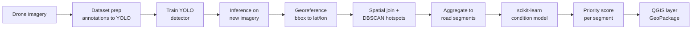

# Drone-Based Pavement Distress Detection & Maintenance Prioritization

Detect and classify road-surface distress (cracks, potholes) from **UAV / drone imagery**
using a deep-learning object detector, then **geolocate** each detection, **aggregate** it
onto road segments, predict condition where no imagery exists, and export a
**QGIS-ready prioritization layer** that ranks which segments need maintenance first.

> The goal is not only to detect damage on an image, but to turn raw drone footage into a
> decision-support product for **infrastructure asset management** — collect condition data,
> centralize it, analyze it, and recommend where to intervene first.

---

## Why this project

Manual road inspection is slow, subjective, and expensive. Drones survey pavement quickly,
but the raw imagery is only useful once it becomes **structured, geolocated, prioritized
information**. This project builds that bridge end to end:

`drone image → detected distress → geographic location → per-segment score → predicted condition → map`

---

## Two complementary ML engines

This project deliberately uses the **right tool for the right job** — a distinction that
matters in practice:

| Engine | Library | Job | Data type |
|---|---|---|---|
| **YOLO detector** | PyTorch / ultralytics | Find & classify distress on imagery | Images (deep learning) |
| **Segment condition model** | scikit-learn | Predict condition from segment attributes | Tabular (classic ML) |

The deep-learning model sees the pixels; the classic model reasons over engineered features
(distress counts, road class, traffic volume) to **estimate condition on segments the drone
never flew over** — the same imputation logic used in real asset-management workflows.

---

## Pipeline



---

## Key concepts practiced

**Computer vision / deep learning:** object detection, transfer learning, train/val/test
split, mAP / precision / recall evaluation.

**scikit-learn (classic ML):** `Pipeline` + `ColumnTransformer` (categorical encoding,
scaling), **Random Forest** & **Gradient Boosting**, **cross-validation**, **GridSearchCV**
hyperparameter tuning, **feature importance**, regression & classification **metrics**
(MAE / RMSE / R², or precision / recall / F1 + confusion matrix), and **DBSCAN** clustering
for geographic distress hotspots (unsupervised).

**GIS / geospatial:** coordinate reference systems (geographic vs projected, EPSG codes),
vector data & GeoDataFrames, **spatial joins**, **buffers**, **reprojection**, raster data
& affine transforms (orthomosaic georeferencing), and **graduated (choropleth) symbology**
in QGIS.

> Every concept above earns its place in the pipeline. Nothing is added just to appear on a
> checklist — if a technique had no logical use here, it was intentionally left out.

---

## Data

Built around open UAV pavement-distress datasets:

| Dataset | Content | Notes |
|---|---|---|
| **UAV-PDD2023** | ~2,440 drone images, ~11k instances (6 classes) | Small, good starting point |
| **RDD2022** (drone subset) | Multi-national road-damage images incl. a UAV subset | Larger, more varied |

Datasets are **not** committed. See [`data/README.md`](data/README.md) for download & placement.
Distress classes: longitudinal crack, transverse crack, oblique crack, alligator crack,
pothole, repair.

---

## Installation

```bash
git clone https://github.com/<your-username>/pavement-distress-drone.git
cd pavement-distress-drone
python -m venv .venv && source .venv/bin/activate   # Windows: .venv\Scripts\activate
pip install -r requirements.txt
```

A GPU helps for training YOLO. If you don't have one, the training step runs well on a free
**Google Colab** or **Kaggle** GPU notebook. The scikit-learn steps run fine on any CPU.

---

## Usage

```bash
# 1. Convert dataset annotations to YOLO format
python -m src.data.prepare_dataset --config configs/config.yaml

# 2. Train the YOLO detector
python -m src.train.train --config configs/config.yaml

# 3. Run inference on new drone imagery
python -m src.inference.detect --config configs/config.yaml --images data/new_survey/

# 4. Georeference detections (image geotags or orthomosaic transform)
python -m src.geo.georeference --config configs/config.yaml

# 5. Aggregate to road segments (spatial join + DBSCAN hotspots)
python -m src.geo.aggregate_to_segments --config configs/config.yaml

# 6. Train the scikit-learn condition model & predict per-segment condition
python -m src.model.segment_model --config configs/config.yaml

# 7. Export a QGIS-ready GeoPackage
python -m src.geo.export_qgis --config configs/config.yaml
```

---

## Project structure

```
pavement-distress-drone/
├── configs/config.yaml               # single source of truth for paths & params
├── src/
│   ├── data/prepare_dataset.py       # annotations -> YOLO format
│   ├── train/train.py                # train the YOLO detector
│   ├── inference/detect.py           # run detection on new imagery
│   ├── model/segment_model.py        # scikit-learn tabular condition model
│   └── geo/
│       ├── georeference.py           # pixel bbox -> geographic coordinates
│       ├── aggregate_to_segments.py  # spatial join + DBSCAN + priority score
│       └── export_qgis.py            # write GeoPackage / GeoJSON for QGIS
├── notebooks/                        # exploration & demo
├── data/                             # datasets (git-ignored)
├── models/                           # trained weights (git-ignored)
└── outputs/                          # detections, maps, layers
```

---

## Results

*To be filled in as the project progresses.* Report per-class precision/recall and mAP@50 for
the detector, MAE/RMSE/R² (or F1 + confusion matrix) for the condition model, a few annotated
example images, and a screenshot of the final QGIS prioritization layer. Report the honest
numbers — a clear, reproducible evaluation is worth more than an inflated score.

---

## Roadmap

- [ ] Baseline YOLO detector trained on UAV-PDD2023
- [ ] Per-class detector evaluation on a held-out split
- [ ] Georeferencing from image EXIF geotags
- [ ] Orthomosaic support (GeoTIFF affine transform)
- [ ] Spatial join + DBSCAN distress hotspots
- [ ] scikit-learn condition model (Pipeline, CV, GridSearchCV, feature importance)
- [ ] Segment-level priority scoring
- [ ] QGIS layer export + example map
- [ ] Short demo notebook
- [ ] (Stretch) Streamlit demo for drag-and-drop inference

---

## License

MIT — see [LICENSE](LICENSE).

## Author

**Akram Bouznad** — Research Master's (M.A.Sc.), Industrial Engineering (Data Science),
Polytechnique Montréal / CIRANO.
